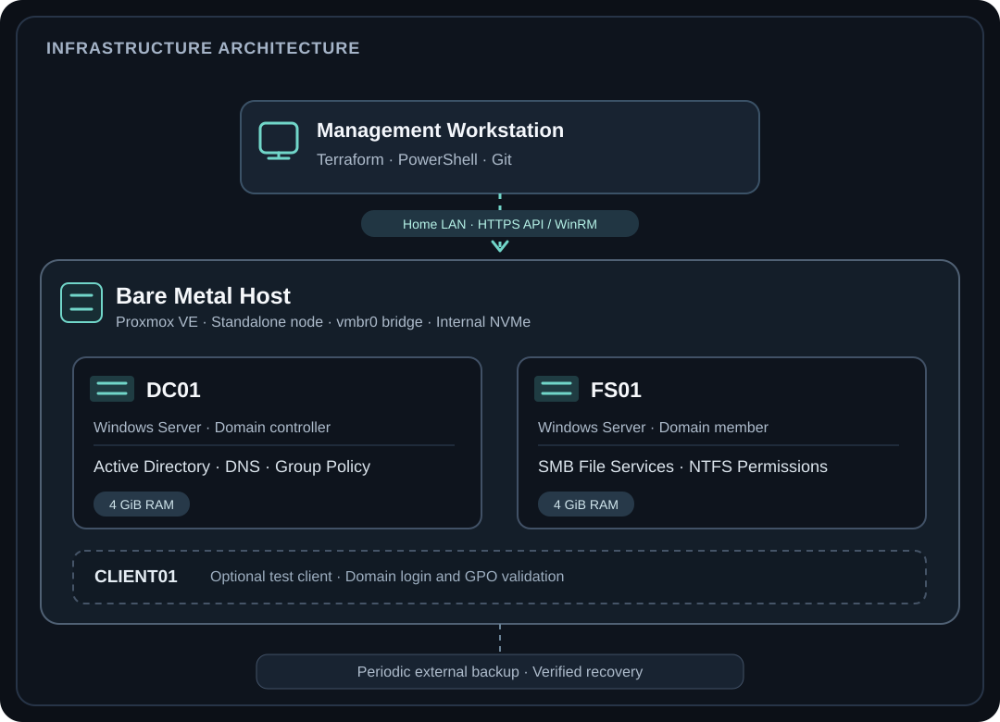

# Automated Windows Infrastructure Lab

A hands-on, single-node infrastructure engineering lab for provisioning, administering, validating, and recovering Windows Server infrastructure using **Proxmox VE**, **Terraform**, **PowerShell**, **Active Directory**, and **DNS**.

## Objectives

- Operate a standalone Proxmox VE host with documented networking, storage, access control, and recovery procedures.
- Provision and manage Windows Server VMs reproducibly through Terraform.
- Configure AD DS, integrated DNS, a domain-joined member server, SMB shares, and Group Policy using PowerShell where appropriate.
- Automate basic user/group/OU administration and joiner–mover–leaver (JML) test scenarios.
- Produce repeatable validation, troubleshooting, backup/restore evidence, and a documented v1.0.0 release.

## Infrastructure components

| Component | Role | Design allocation |
|---|---|---|
| Bare Metal Host | Standalone Proxmox VE node | Shared physical resources |
| Management Workstation | Terraform, PowerShell, Git and documentation | Separate Windows workstation |
| DC01 | Windows Server domain controller and DNS | 2 vCPU, 4 GiB RAM, 55 GiB virtual disk |
| FS01 | Windows Server member server and SMB file services | 2 vCPU, 4 GiB RAM, 65 GiB virtual disk |
| CLIENT01 | Optional domain-joined test client | Provisioned when sufficient resources are available |

Resource allocations are design targets and must be validated against actual utilisation. VM virtual-disk sizes are not the same as physical space consumed on thin-provisioned storage. Exact addresses, host identifiers, credentials, and hardware inventory are excluded from this public repository.

## Automation boundaries

**Terraform** provisions and manages Proxmox virtual resources. **PowerShell** configures Windows and its infrastructure roles. The management workstation runs both tools initially; a dedicated automation VM is not required.

## Roadmap

| Phase | Outcome | Verification checkpoint |
|---|---|---|
| 0 — Plan | Hardware assessment, architecture, repository baseline | Design and installation risks reviewed |
| 1 — Platform | Proxmox installation, network, storage, admin access | Stable management, storage and network checks |
| 2 — Guest baseline | Clean Windows Server installation/template | Reusable baseline and remote administration tested |
| 3 — Infrastructure as code | Terraform VM provisioning and lifecycle | Disposable VM plan/apply/change/destroy tested |
| 4 — Core services | DC01 AD DS/DNS and domain-joined FS01 | DNS, domain membership, authentication validated |
| 5 — Identity and access | AD, JML, file permissions and GPO automation | Idempotence and intended access behaviour verified |
| 6 — Operations | Health checks, failure scenarios, backup/restore | Recorded evidence and successful recovery test |
| 7 — Release | Integration, documentation, sanitisation | Acceptance criteria met and v1.0.0 tagged |

The optional client and supplementary frameworks are not v1.0.0 prerequisites. Project completion is defined by the acceptance criteria in [Architecture](docs/architecture.md).

## Documentation

- [Architecture, resource assumptions, and acceptance criteria](docs/architecture.md)
- [Design decisions and project conventions](docs/design-decisions.md)
- [Project log and milestone status](docs/project-log.md)
