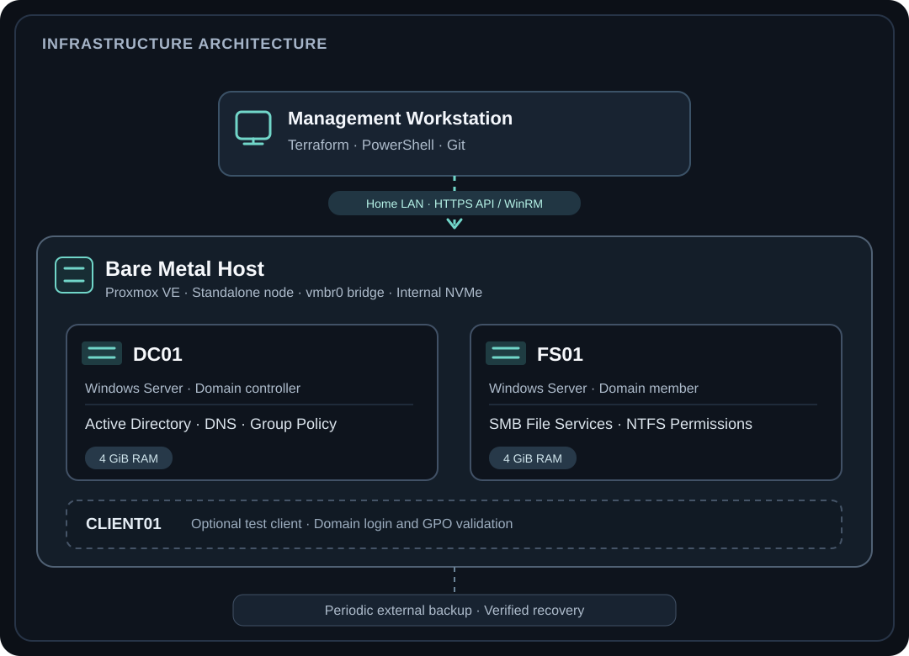

# Infrastructure architecture

## System boundaries

- **Bare Metal Host:** one standalone Proxmox VE node; integrated Ethernet uplink; existing internal NVMe used for the hypervisor and VM disks.
- **Management Workstation:** separate Windows computer running Terraform, PowerShell 7, Git, and administration tools.
- **DC01:** Windows Server with Active Directory Domain Services (AD DS) and AD-integrated DNS.
- **FS01:** Windows Server joined to the lab domain; SMB shares and NTFS permissions.
- **CLIENT01:** optional Windows test client, permitted only after storage and memory usage are measured.

The baseline has no dedicated automation server, cluster, Ceph storage, Kubernetes, cloud directory sync, or additional physical storage purchase.

## Logical management and service flows

1. Management workstation to Proxmox HTTPS API: Terraform provisions and changes VM resources through scoped credentials.
2. Management workstation to Windows guests: PowerShell remoting (WinRM) after network, authentication, and firewall prerequisites are verified.
3. Member servers and optional clients to DC01: AD-integrated DNS and domain authentication.
4. Domain users/groups to FS01: authorised SMB access controlled by share and NTFS ACLs.
5. External removable storage: backup/export destination when attached, not live critical VM storage.

## Resource planning

| Component | vCPU | Memory | Virtual disk |
|---|---:|---:|---:|
| DC01 | 2 | 4 GiB | 55 GiB |
| FS01 | 2 | 4 GiB | 65 GiB |
| CLIENT01 (optional) | 2 | 4 GiB | To be sized after verification |

Available physical resources, subject to pre-installation verification: approximately **32 GiB memory and 256 GB nominal internal NVMe**. Keep a host memory budget and adequate physical free space. Decide on a Windows image/template and its additional disk consumption only after checking installed storage capacity and actual thin-pool behaviour.

**Storage design:** ext4/LVM-thin for the single internal drive; local directory storage for supported file content and local-lvm for VM volumes, subject to checking the installer layout. Do not treat provisioned virtual disk capacity as physical free space. Avoid sustained snapshots on a nearly full disk.

## Network design

- One Proxmox Linux bridge, `vmbr0`, over the existing Ethernet uplink.
- A static, documented management address; fixed/reserved addresses for server VMs.
- Domain members use DC01 as their DNS resolver.
- Existing home router continues handling LAN DHCP and gateway routing.
- No competing DHCP service or changes to household DNS defaults.
- No internet-facing Proxmox UI, WinRM or SMB administration endpoints.
- The lab domain name and IP range remain private and will be selected before deployment. Public examples should use reserved documentation names and addresses only.

This initial bridged design trades stronger network isolation for simpler management. Reassess isolation if the home network or failure simulations make it necessary.

## Deployment and recovery boundaries

- Start from a clean, non-domain-joined Windows Server baseline; generalise before templating. Do not use a promoted domain controller as a general-purpose template.
- Separate provisioning of VMs from guest-side promotion/domain configuration.
- Validate Terraform plans, especially operations that could replace or destroy persistent infrastructure; test destruction on disposable VMs, **not** DC01 or FS01.
- Use external backups where available and test a supported restore procedure. Snapshots alone are not a backup strategy.
- AD DS recovery procedures must be documented and tested with attention to domain controller identity and system state; VM restoration alone is not automatically an acceptable recovery procedure for every AD incident.

## Risks and controls

| Risk | Initial control |
|---|---|
| Host network/driver instability | Check interface identity, kernel messages and sustained connectivity before domain deployment |
| Single NVMe capacity exhaustion | Monitor actual thin-pool allocation and free space, remove disposable artefacts |
| Host installation data loss | Confirm ESXi can be erased; verify recovery/installation media before formatting |
| DNS misconfiguration affects household devices | Retain router DHCP/DNS settings; configure lab members explicitly |
| Terraform destructive change | Review every plan; isolate tests; prevent accidental persistent-VM destroy |
| Public repo leaks credentials/state/identifiers | Ignore local state, secrets and values; inspect Git diff and SVG content before commits |
| Evaluation licensing time window | Verify legal evaluation terms and record installation/expiry dates privately |

## Release acceptance criteria

All the following must have evidence before v1.0.0:

1. Proxmox management, network and storage baseline verified.
2. Terraform successfully creates, modifies and destroys a **disposable** test VM; repeatability demonstrated.
3. DC01 serves working AD DS and DNS; FS01 is domain joined and authenticates.
4. SMB share and NTFS access controls are tested with allowed and denied access.
5. PowerShell scripts safely manage lab OUs, users, groups and JML scenarios on repeat execution.
6. At least one Group Policy application is confirmed and troubleshot if necessary.
7. Health/configuration validation produces meaningful pass/fail/error evidence.
8. A supported backup and restore test is completed, with limitations recorded.
9. Documentation, diagrams and sample output are reviewed and sanitised; release tag `v1.0.0` is published.

Optional CLIENT01, Ansible, Packer, DSC, and additional infrastructure are outside the mandatory completion criteria.
